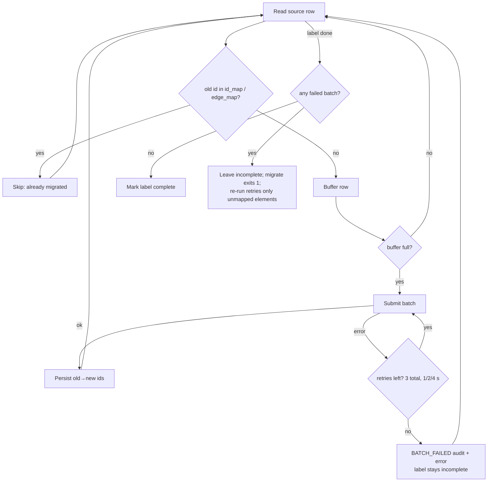
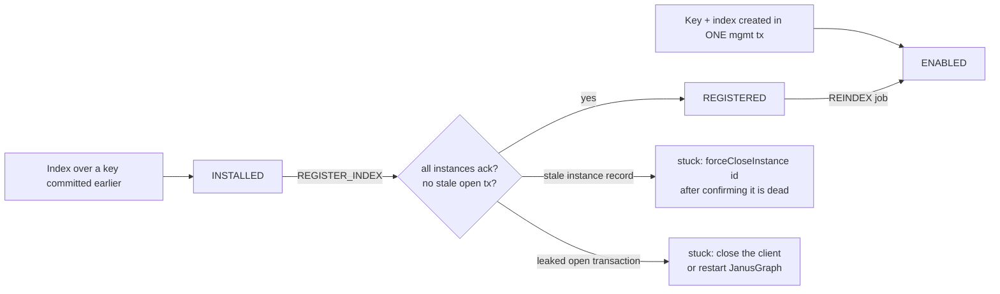
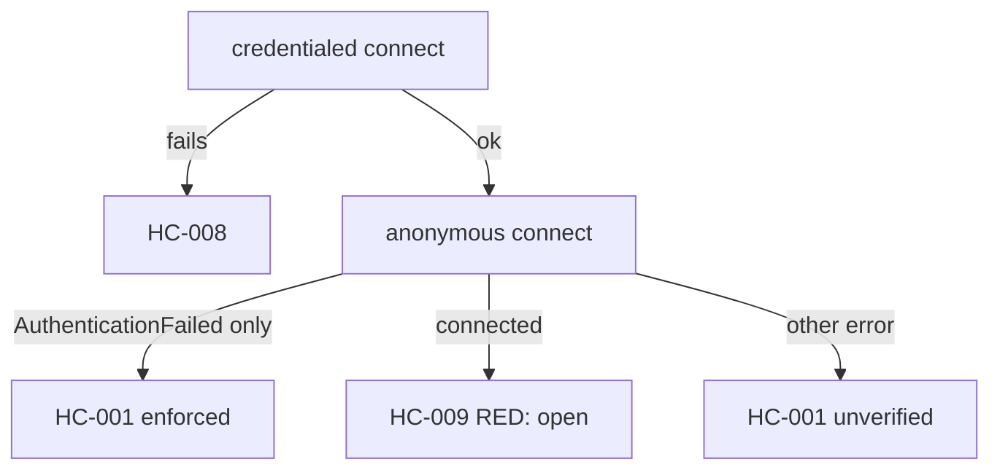

# Learnings

Findings from building and live-testing the DSE Graph → JanusGraph / HCD migrator. Each entry states what
was observed, where it was verified, and what the code or docs now do about it. Repeated items become skills.

---

## 1. JanusGraph property data types

- Use only the **documented** native types ([Property Key Data Type](https://docs.janusgraph.org/schema/#property-key-data-type)):
  String, Character, Boolean, Byte, Short, Integer, Long, Float, Double, Date, Geoshape, UUID, plus primitive
  arrays such as `byte[]` (`janusgraph/docs/advanced-topics/serializer.md`).
- `java.time.Duration` and `Instant` are accepted by a live server only because `StandardSerializer` registers
  them internally (registrations 64/65). That is not a public contract, so the migrator does not rely on it.
- The server rejects `LocalDate`, `LocalTime`, `BigDecimal`, `BigInteger` and `InetAddress` ("Not a supported data type").
- There is no `BigDecimal` support anywhere in `janusgraph-core`, `janusgraph-es` or the driver. A custom attribute
  (`attributes.custom.*`) needs a Java serializer jar on every server and still cannot be mixed-indexed:
  `ElasticSearchIndex` maps only Float/Double/Byte/Short/Integer/Long.
- The OpenSearch mixed index supports Number, Date, Instant, Boolean, UUID, String and Geoshape — **not** Duration.
- Guarded by `tests/unit/test_translator.py::test_type_map_targets_are_documented_janusgraph_types`.

## 2. DSE value types as actually stored

Read from `bdp/dse-graph/.../gcore/datastore/BasicValueTypeInternal.java` (Classic) and
`bdp/dse-graph-server/.../graphv2/dsedb/schema/{Column,ColumnUtils}.java` (Core):

| DSE type | Stored as | Migrated as |
|---|---|---|
| `Decimal` | `BigDecimal` (unbounded; DSE docs recommend it for currency) | `Double` (default; inexact values counted) or exact `String` (`--decimal-strategy string`) |
| `Duration` (Classic) | `java.time.Duration`, bigint millis | `Long` millis |
| `Duration` (Core) | CQL `duration(months, days, nanos)` — no `java.time` conversion exists | ISO-8601 `String` |
| `Date` | `LocalDate`, encoded by DSE itself as midnight UTC | `java.util.Date` at midnight UTC |
| `Inet` | `InetAddress`; DSE's text form is `getHostAddress()` | the same text |

- The DSE docs (`dse-docs-new/modules/graph/pages/reference/data-types.adoc`) describe Duration as "milliseconds";
  that is true for Classic only. The Core source is authoritative.
- gremlin-python sends a naive `datetime` as UTC (`calendar.timegm(obj.utctimetuple())`), so no client-timezone shift.

## 3. gremlin-python `elementMap()` keys are tokens, not strings

`elementMap()` returns `T.id` / `T.label` and, for edges, `Direction.OUT` / `Direction.IN` (each a nested
`{T.id, T.label}` map). Code that reads `"~id"` or `"~outV"` silently finds nothing. `Migrator._split_element_map()`
handles both forms.

## 4. Batch writes: retry and idempotent resume

- `addV`/`addE` are not idempotent, so "re-run the label" is only safe because mapped elements are skipped.
- Edges wait until **every** vertex label is complete; otherwise a failed vertex batch would silently drop edges.
- Residual risk: a batch committed server-side whose response times out is retried and duplicated.

## 5. Running the stack with Podman on Apple Silicon

- `podman-compose` does not reliably honour `depends_on: condition: service_healthy`, and `up <svc>` recreates the
  service's dependencies. Use `docker/up.sh` (`--no-deps`, ordered, health-gated).
- A container keeps the healthcheck it was **created** with; `podman restart` does not pick up compose edits —
  use `up -d --no-deps --force-recreate <svc>`.
- DSE: `nodetool status` reported `UN` while CQL refused connections; the healthcheck now runs `cqlsh`.
- **DSE 6.8 cannot boot under QEMU; DSE 6.9 can.** 6.8 (Java 8) wedged on every boot (5 attempts, each at a different
  step). Evidence: every log incl. `gc.log` stops right after a normal safepoint, the JVM ignores `SIGQUIT` (a thread
  dump needs a safepoint), no OOM, free VM memory; more CPUs (6 → 8) and dropping Search did not help. DSE 6.9.26
  (Java 11) — like HCD on Java 17 — boots in ~3.5 min with `-g -s`. Use 6.8 only on a native `amd64` host.
- A Podman VM restart (or host power loss) drops the QEMU binfmt registration; re-apply it (`docker/README.md`).
  After a host sleep/power event the JanusGraph process may survive with a jumped clock; restart it.
- Rich (the CLI's console) wraps long lines at terminal width — CLI tests should compare whitespace-normalised output.

## 6. gremlin-python ↔ DSE / JanusGraph wire details

- **Use GraphSON v3 to read DSE.** DSE's GraphBinary carries types gremlin-python cannot decode at all (Classic
  `Timestamp` → `131 is not a valid DataType`, Core `Duration` → `0 is not a valid DataType`). GraphSON leaves unknown
  types as `{'@type', '@value'}` dicts, which `_from_graphson()` decodes. Core data is read over CQL anyway.
- **`elementMap()` drops values** of a multi-valued (Classic `.multiple()`) property; `valueMap(true)` returns all.
- **A plain Python `int` is sent as int32** → `struct.error` for `Bigint` values; wrap in `gremlin_python.statics.long`.
- **cassandra-driver collection types are not the Python builtins:** maps are `OrderedMapSerializedKey` (a
  `Mapping`, not a `dict`), UDTs are namedtuples, tuples are `tuple`. Check `collections.abc.Mapping`, and handle UDTs
  and tuples *before* any generic "tuple → list" conversion, or a UDT becomes repeated values of one key.
- **A request the server cannot decode is never answered** (Netty `DecoderException` with no request id), so every
  `.result()` needs a timeout or the client blocks forever.
- **Seeder blocks are separate sessionless requests:** a variable assigned in one blank-line block is undefined in the
  next. Guarded by `test_template_blocks_do_not_share_script_variables`.

## 7. JanusGraph index registration

- The ack waits for **every** registered instance and for every transaction open at registration time. A container
  restart can leave the old instance registered; one leaked transaction ("Stale transaction alert" in the server log)
  blocks it too. `init-target` reports both — it never force-closes or rolls back, because those may be live.
- Keep each lifecycle action in its own short request: the server's `evaluationTimeout` is 30 s, so the REINDEX job is
  started, not awaited.

## 8. Verify with values, not counts

Counts hid several bugs: a schema the parser could not read gave "0/0 passed"; templates silently produced 49 edges
for `--edge-count 100`; UDTs and tuples migrated as their last field only. Every live check here compares source and
target values field by field (`.scratch/live-probes/cmp_*.py`), plus an index-backed query per index type.

## 9. Onboarding: test the README as a new user would

A fresh-user run of the README failed at step 2, and fixing it surfaced six more problems none of the unit tests or
the developer workflow had hit:

- `docker compose up -d` under Podman (podman-compose 1.5) returns at once — no `--wait`, no `service_healthy` wait.
  `./docker/up.sh` is the one start command; Docker Compose v2 users can use `up -d --wait`.
- podman-compose honours `stop_grace_period` only in its own `stop`/`down`; containers keep a 10 s stop timeout unless
  created with `--stop-timeout` (`up.sh` passes `--podman-run-args=--stop-timeout=120`). Under emulation 10 s kills
  DSE mid-flush, and the next start can fail replaying the commit log (exit 100).
- `podman rm -f` refuses containers that others depend on — remove in reverse dependency order.
- DSE caps every request at 30 s (`realtime_evaluation_timeout`) and ignores a per-request `evaluationTimeout`; long
  Groovy loops must be chunked by the client.
- Silent success is the worst failure: with the source down, `assess` passed its gate and `analyse` wrote an empty
  analysis. Every stage must fail loudly when it inspected nothing.
- Defaults must be exercised too: the quick start used small sizes and passed, while `seed`'s own defaults failed.
- Resetting the target must also clear the client-side checkpoints, or the next `migrate` of the same graph finds every
  label "already complete" and writes nothing. Stop JanusGraph *before* dropping its keyspace: no writes race the
  drop, the instance deregisters cleanly, and no stale instance or leaked transaction blocks later index registration.

## 10. HCD authentication is off in the image — verify it, don't assume it

- The HCD 2.x image's `cassandra.yaml` configures `AdvancedAuthenticator` / `AdvancedAuthorizer` but ships their
  `enabled: true` lines **commented out**, so HCD accepted any client with any (or no) password. A successful
  credentialed connection therefore proves nothing; HC-001 used to claim "authenticator confirmed active" from it.
- The assessor now also tries an **anonymous** connection (connect only). The driver signals "credentials required"
  as `NoHostAvailable` whose `errors` are all `AuthenticationFailed('Remote end requires authentication')` → HC-001.
  A successful anonymous connect → HC-009 (RED). Anything else is reported as unverified, never as enforced.
- Don't mount a whole `cassandra.yaml` to change one setting: the image's entrypoint then skips its network
  auto-configuration (`HCD_AUTO_CONF_OFF`), and a copy binding `rpc_address: localhost` made CQL unreachable from
  other containers. Patch the image's own file in a wrapper entrypoint (`docker/hcd-entrypoint.sh`) and fail the
  start if the expected lines are missing, so an image change can never silently start an open database.
- JanusGraph's backend credentials are `storage.username` / `storage.password` — **not** `storage.cql.*`. JanusGraph
  silently ignores unknown keys, so the wrong ones "worked" for as long as HCD let everyone in. Turning a security
  control on is also a test of every client's configuration; check keys against `janusgraph/docs/configs/janusgraph-cfg.md`.
- A required password (`${VAR:?msg}`) is interpolated by **every** compose command, including `stop` and `down`;
  the README therefore sets `HCD_CQL_PASSWORD` once per terminal before any command.
- Keep `: ` (colon-space) out of the `:?` message in a list-style `environment:` entry: YAML then parses the item as a
  mapping and podman-compose crashes (`'dict' object has no attribute 'split'`). Check with `podman-compose … config`.

## 11. A clean slate is more than `rm --all`

`podman rm --force --all` removes every container on the machine, yet leaves this stack's named volumes — and with
them a DSE commit log it cannot replay (exit 100) — plus the network and `./out`. `down -v` only covers the current
compose project (the directory name), so volumes created from another checkout survive. `./docker/up.sh --clean`
removes the stack's containers in reverse dependency order (with their anonymous volumes), every `*_hcd-data` /
`*_opensearch-data` / `*_dse-data` volume, `*_migrator-net` and `./out`, after listing them — and keeps the images.
